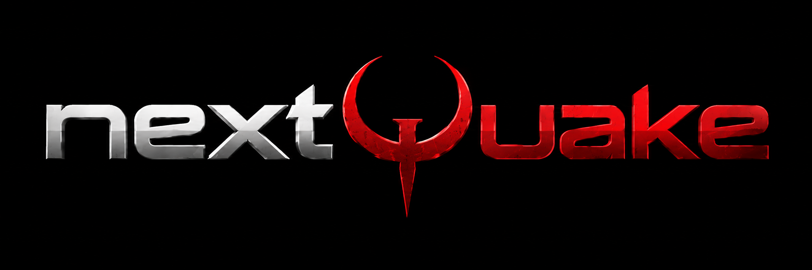

# nextQuake

A QuakeWorld client focused exclusively on **Android and iOS**, based on [QW-Group's ezQuake](https://github.com/QW-Group/ezquake-source). nextQuake is an independent project, not an official QW-Group release.

## Current status

- Android arm64: SDL3, Vulkan, Oboe audio, touch controls, console, and Android keyboard integration.
- Android Debug and Release builds were validated in the imported base at commit `52fab4df`. This checkout has not received a new build yet.
- iOS: the port has not been implemented yet. The planned approach uses SDL3, Vulkan through MoltenVK/Metal, SDL audio, and iOS storage and keyboard integration.
- Inherited desktop code remains as infrastructure; desktop is not a target platform for this project.

## Android installation

**Installing the APK alone is not enough: the client also needs Quake/nQuake/ezQuake game data in the correct folder.** The current Android build requires Android 10 or newer, an arm64 device, and Vulkan support.

1. Install the provided release APK. If Android asks, allow APK installation for the browser or file manager you are using. The application may still appear as **ezQuake**.
2. Obtain a working nQuake/ezQuake installation on your computer, including its game data. Keep a backup of your existing configuration before copying or merging files.
3. Connect the phone to your computer using USB file transfer, or use a file manager on the phone. In **internal storage**, create this exact folder:

   ```text
   Documents/ezQuake
   ```

   Its full Android path is:

   ```text
   /storage/emulated/0/Documents/ezQuake
   ```

   Keep the spelling and capitalization shown above. The folder is still named `ezQuake`, even though this project is named nextQuake.

4. Copy the `id1`, `qw`, and `ezquake` folders from your nQuake/ezQuake installation directly into that folder, preserving their contents and directory structure. The result should look like this:

   ```text
   Documents/
   └── ezQuake/
       ├── id1/
       │   ├── pak0.pak
       │   └── pak1.pak          (if included in your registered Quake installation)
       ├── qw/
       │   └── ...              (maps, configs, skins, sounds, and packages)
       └── ezquake/
           ├── ezquake.pk3
           └── ...              (other ezQuake assets)
   ```

   Copy the folders' full contents, not just the example files. Do not create an extra nested folder such as `Documents/ezQuake/nQuake/id1` or `Documents/ezQuake/ezQuake/id1`. Keep `.pak` and `.pk3` files intact; do not extract them. Windows executables are not needed on Android.

5. Open the app and grant the requested storage access. On Android 11 or newer, enable **Allow access to manage all files** for the app when prompted, then return to it. On Android 10, allow the requested storage permission.
6. Wait for startup to finish. The game may initially open at the console; use the on-screen **KBD** button to enter commands. Touch controls are enabled automatically by default (`in_touch 2`).

### Automatic download and missing data

The current launcher attempts to download its configured game data when it cannot find base data. If you use this option, allow the download to finish and keep an internet connection available. Manual copying is useful when downloads fail or when you want to use your existing installation.

The launcher's base-data check is not a complete installation check: finding `id1/pak0.pak` or another recognized base file can skip the download even if other assets are missing. If the app reports missing files, verify the folder structure and copy the complete `id1`, `qw`, and `ezquake` directories rather than only `pak0.pak`.

If some maps display unexpected simple textures, check your data packages: an inherited `id1/gpl_maps.pk3` can contain replacement maps that override the originals. Preserve a backup before changing any game data.

## iOS installation

An iOS build is not available yet. The Android APK and Android storage instructions do not apply to iPhone.

## Development

Read `AGENTS.md`, `continue.md`, and `docs/android-pocket-vulkan-handoff.md` before changing the controls or renderer. The original history has been preserved to track authorship and technical decisions.

To build for Android, configure JDK 17, the Android SDK, and the NDK as described in the handoff, then run `gradlew.bat :app:assembleDebug` or `gradlew.bat :app:assembleRelease`.

Building for iOS requires macOS and Xcode, locally or remotely. No IPA is available, and the client has not been validated on an iPhone.

## License and game data

Credit goes to QW-Group, the ezQuake authors, and the contributors to the original code. The GNU GPL v2 license inherited from ezQuake is preserved in [LICENSE](LICENSE). Keep the original copyright notices and author attribution. Proprietary Quake game data (PAK/PK3 files and maps) is not included in this repository.

The application's display name and Android package identifier are still inherited from ezQuake. Updating the application branding will be a separate task.
